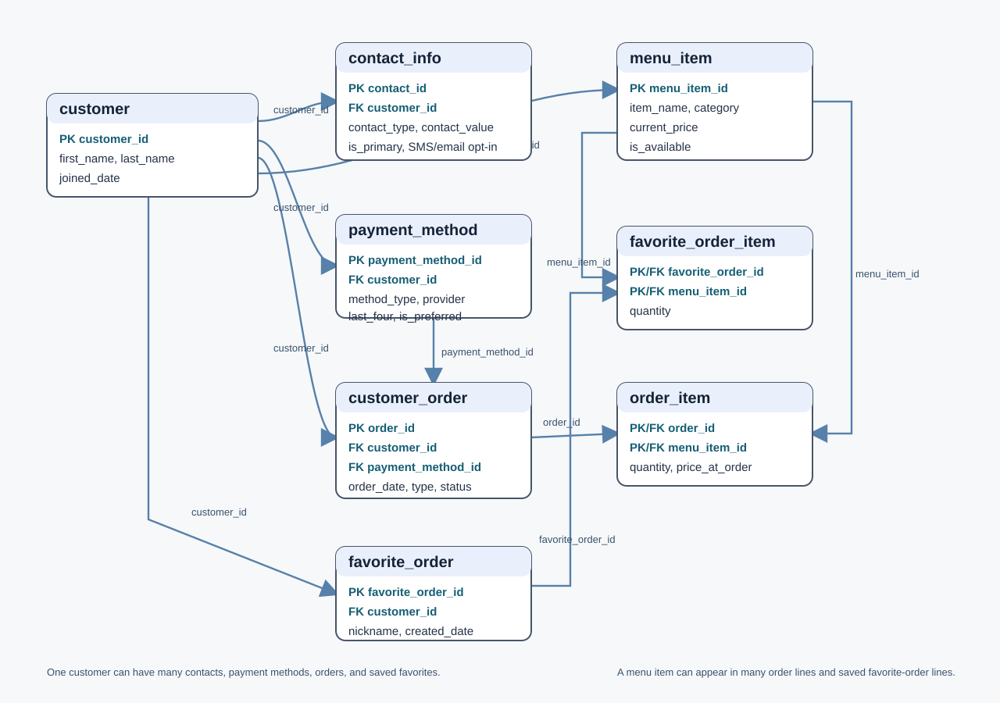

# Restaurant Favorites: Natural Language to SQL

My project models fictional restaurant customers, their contact preferences, preferred payment methods, completed orders, and saved favorite orders. The database separates menu items from both purchased order lines and saved favorite-order lines. Each purchased line stores its price at the time of the order, so later menu price changes do not change past totals.



## Prompting strategies and results

I compared zero-shot prompting with single-domain double-shot prompting using the same schema, sample data, eight questions, and `gpt-4o-mini`. The two current response logs are included in `results/`. Fourteen of sixteen generated SQL queries executed. Both strategies failed on the completed-spending question because the generated query used the nonexistent alias `coi`. The query errors and returned rows are documented in [examples.md](examples.md).

Both strategies correctly found the customers without an SMS-capable phone number, the items in Maya Chen's saved “Friday Pizza Night” order, and the customers and dates for Chocolate Cake orders. Both identified Maya Chen as the customer with the most completed orders, although the zero-shot response gave a customer ID instead of her name.

Both strategies made a mistake on the top-selling menu items. They summed order lines without filtering out cancelled orders, so Riley Morgan's cancelled order caused Spicy Chicken Sandwich to appear tied for the lead. The correct leaders among completed orders are Margherita Pizza, Garden Salad, and Iced Tea, with three units each.

For the payment preference count, zero-shot included the `is_preferred = 1` condition and returned one mobile-wallet customer. The single-domain double-shot query did not include it and returned two, counting Maya's nonpreferred Apple Pay. My own question was “Customers who prefer Google Pay or Apple Pay.” Both strategies returned Maya and Sam, but only Sam is correct: Maya has Apple Pay saved, while Visa is marked as her preferred payment method. This showed that “has saved” and “prefers” require different SQL conditions.

These results showed me that SQL can execute successfully and still be semantically wrong. I checked the generated SQL and result rows against the database rules rather than relying on the friendly answer alone.

## Example that worked

**Question:** What items are in Maya Chen's Friday Pizza Night favorite order?

**Rows returned by both strategies:** `Margherita Pizza (1)`, `Iced Tea (2)`.

**Friendly answer:** Maya Chen's Friday Pizza Night favorite order includes one Margherita Pizza and two Iced Teas.

## Example that did not work as expected

**Question:** Customers who prefer Google Pay or Apple Pay

**Generated result from both strategies:** Maya Chen and Sam Brooks.

**Problem:** Both queries matched wallet providers but omitted `payment_method.is_preferred = 1`. Maya has Apple Pay saved as a payment option, but her preferred method is Visa.

**Corrected SQL:**

```sql
SELECT DISTINCT c.first_name || ' ' || c.last_name AS customer_name
FROM customer c
JOIN payment_method pm ON c.customer_id = pm.customer_id
WHERE pm.is_preferred = 1
  AND pm.provider IN ('Google Pay', 'Apple Pay')
ORDER BY customer_name;
```

The corrected result is Sam Brooks.

## Individual contribution

I designed the restaurant schema and sample data, ran both prompting strategies with my own API key, added the Google Pay / Apple Pay question, and checked the generated SQL and results. My schema diagram, eight-question results, and run logs are included with the project. I will complete the paper reading, individual self-report, and required peer reviews as described in the assignment.
